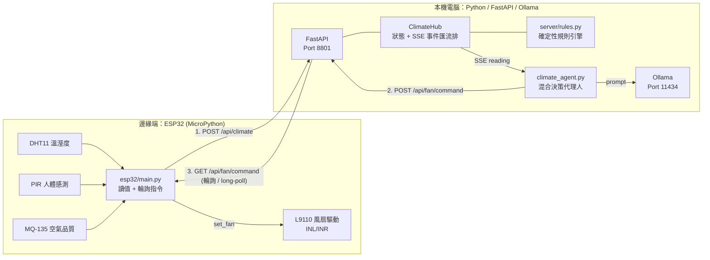

# esp32-mcp-climate-control

**ESP32 + FastAPI + Ollama 智慧風扇控制**：ESP32 上報 DHT11 溫溼度、PIR 人體動態與 MQ-135
空氣品質，由本機 FastAPI 傳輸層串流，交給「規則引擎 + LLM」混合決策後回推風扇指令。

### 系統架構



資料流：ESP32 上報讀值 → FastAPI 存進 `ClimateHub` → 規則引擎先算出初步指令 →
透過 SSE 推播 `reading` 事件 → `climate_agent.py` 混合決策後 `POST /api/fan/command` 回推 →
ESP32 以輪詢 / long-poll 取得指令並驅動風扇。

### 快速開始

```bash
pip install -r requirements.txt

# 1. 啟動傳輸層伺服器（Port 8801）
python main.py

# 2. 啟動環境代理人（需先執行 Ollama 並拉取模型）
ollama serve &
ollama pull qwen2.5-coder:3b
python climate_agent.py --model qwen2.5-coder:3b

# 3.（選用）沒有 Ollama 時，改用佔位決策的示範消費者
python examples/mcp_agent_consumer.py
```

互動式 API 文件：<http://127.0.0.1:8801/docs>

### ESP32 接線表

| 元件 | ESP32 腳位 | 備註 |
| --- | --- | --- |
| DHT11 溫溼度 | GPIO 21 | 量測範圍 0~50 °C / 20~90 % |
| PIR 人體感測 | GPIO 14 | 高電位觸發（`PIR_ACTIVE_HIGH = True`） |
| MQ-135 空氣品質 | GPIO 27 | 低電位觸發（`MQ_ACTIVE_LOW = True`） |
| L9110 風扇 | GPIO 22 / 23 | INL / INR，`INL=0/INR=1` 運轉、`INL=0/INR=0` 停止 |

將 `esp32/config.py` 的 `SERVER_HOST` 改成跑 FastAPI 那台電腦的區網 IP，
再以 `mpremote` 把 `esp32/config.py` 與 `esp32/main.py` 上傳到開發板即可。

### API 一覽

| 方法 | 路徑 | 用途 |
| --- | --- | --- |
| `POST` | `/api/climate` | ESP32 上報讀值（JSON） |
| `GET`  | `/api/stream` | SSE 串流，推播 `snapshot` / `reading` / `fan_command` 事件 |
| `GET`  | `/api/fan/command` | ESP32 取得風扇指令（`wait=1` 為 long-poll） |
| `POST` | `/api/fan/command` | MCP / `climate_agent.py` 下達風扇指令 |
| `POST` | `/api/fan/auto` | 把裝置交還規則引擎（解除代理人接管） |
| `GET`  | `/api/health` | 健康檢查 |
| `GET`  | `/api/status` | 系統快照（裝置、最新讀值、風扇狀態） |

### 核心亮點

- **🔒 三層安全底線**
  - **MQ-135 優先**：氣體異味超標時由程式碼強制開風扇，完全不經 LLM。
  - **極端氣候保護**：`T ≥ 31°C` 或 `H ≥ 75%` 視為極端，強制開啟；過冷則維持關閉（風扇無法加熱）。
  - **安全封套**：AI 若在「需要降溫且有人在場」或極端氣候下試圖關風扇，程式碼強制覆寫為 `ON`。

- **🧠 混合分工機制**
  - **遲滯預處理**：溫濕度由規則引擎轉為布林旗標（`T ≥ 28°C` 或 `H ≥ 70%` 開；`T ≤ 26°C` 且 `H ≤ 65%` 關），模型看不到原始數字，杜絕幻覺。
  - **AI 節能調度**：模型只權衡 PIR 人體佔用，無人且非極端時自動 `OFF` 省電。
  - **決策與理由分離**：正式 `reason` 一律由程式依真實讀值生成，模型自由文字僅供觀測，不會與數據矛盾。

- **🛡️ 穩定與防護**
  - **防連跳護欄**：非緊急切換需間隔 `--min-switch-seconds`（預設 30 秒），保護硬體；MQ 與極端狀況視為緊急、可立即切換。
  - **自動降級**：Ollama 逾時或離線時，無縫退回規則引擎接管（`source=rule-engine`），運作不中斷。
