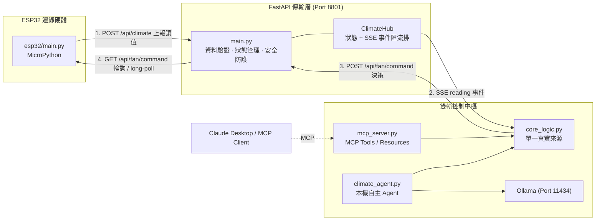

# esp32-mcp-climate-control

**ESP32 + FastAPI + Ollama + MCP 智慧氣候控制**：ESP32 上報溫溼度、人體動態與空氣品質，
由本機 FastAPI 傳輸層串流，交給「規則引擎 + LLM」混合決策後回推風扇指令。

## 系統架構

三層分層：**ESP32 邊緣硬體** → **FastAPI 傳輸層** → **雙軌控制中樞**。



資料流：ESP32 上報讀值 → FastAPI 存入 `ClimateHub` → 規則引擎算出初步指令並以 SSE 推播 →
控制中樞（MCP 或本機 Agent）混合決策後 `POST /api/fan/command` 回推 →
ESP32 輪詢 / long-poll 取得指令並驅動風扇。

## 模組結構（單一真實來源）

所有與傳輸層通訊的 HTTP 呼叫都集中在 **`core_logic.py`**，`mcp_server.py` 與
`climate_agent.py` 只引用它，不各自重寫連線邏輯：

| 模組 | 職責 |
| --- | --- |
| `main.py` | FastAPI 傳輸層：資料驗證、狀態管理、硬體通訊、安全防護（Port 8801） |
| `core_logic.py` | 與 FastAPI 互動的標準介面：`TransportClient` + `core_*` 便利函式 |
| `mcp_server.py` | MCP 橋樑：把 `core_logic` 包成 Tools / Resources（stdio / JSON-RPC） |
| `climate_agent.py` | 本機 Agent：用同一組 `core_logic` 函式跑自主決策迴圈 |
| `server/` | FastAPI 應用（`app` / `models` / `state` / `rules` / `config`） |

**雙軌控制中樞**：

1. **Claude Desktop 互動模式** — 透過 `mcp_server.py` 將後端能力包裝為標準 MCP Tools / Resources。
2. **本機自主 Agent 模式** — 透過 `climate_agent.py` 結合本機 Ollama，跑背景混合決策迴圈。

**錯誤處理**：`core_logic.TransportError` 統一封裝連線逾時、連線被拒、非 2xx 與 JSON 解碼失敗，
呼叫端不需認識 `httpx` 例外。後端未啟動時 fail-fast 並提示 `is 'python main.py' running?`；
`climate_agent.py` 據此以指數退避自動重連。串流讀取另以 `TransportTimeout`（`TransportError`
子類）界定時限，確保工具呼叫不會因 keep-alive 而無限等待。

## 快速開始

```bash
pip install -r requirements.txt

# 1. 啟動傳輸層伺服器（Port 8801）
python main.py

# 2a. 本機自主 Agent 模式（需先執行 Ollama 並拉取模型）
ollama serve &
ollama pull qwen2.5-coder:3b
python climate_agent.py --model qwen2.5-coder:3b

# 2b. Claude Desktop 互動模式（把 MCP server 掛進 Claude Desktop，見下方 MCP 整合）

# 3.（選用）沒有 Ollama 時，改用佔位決策的示範消費者
python examples/mcp_agent_consumer.py
```

互動式 API 文件：<http://127.0.0.1:8801/docs>

## ESP32 接線表

| 元件 | ESP32 腳位 | 備註 |
| --- | --- | --- |
| DHT11 溫溼度 | GPIO 21 | 量測範圍 0~50 °C / 20~90 % |
| PIR 人體感測 | GPIO 14 | 高電位觸發（`PIR_ACTIVE_HIGH = True`） |
| MQ-135 空氣品質 | GPIO 27 | 低電位觸發（`MQ_ACTIVE_LOW = True`） |
| L9110 風扇 | GPIO 22 / 23 | INL / INR，`INL=0/INR=1` 運轉、`INL=0/INR=0` 停止 |

將 `esp32/config.py` 的 `SERVER_HOST` 改成跑 FastAPI 那台電腦的區網 IP，
再以 `mpremote` 把 `esp32/config.py` 與 `esp32/main.py` 上傳到開發板即可。

## API 一覽

| 方法 | 路徑 | 用途 |
| --- | --- | --- |
| `POST` | `/api/climate` | ESP32 上報讀值（JSON） |
| `GET`  | `/api/stream` | SSE 串流，推播 `snapshot` / `reading` / `fan_command` 事件 |
| `GET`  | `/api/fan/command` | ESP32 取得風扇指令（`wait=1` 為 long-poll） |
| `POST` | `/api/fan/command` | MCP / `climate_agent.py` 下達風扇指令 |
| `POST` | `/api/fan/auto` | 把裝置交還規則引擎（解除代理人接管） |
| `GET`  | `/api/health` | 健康檢查 |
| `GET`  | `/api/status` | 系統快照（裝置、最新讀值、風扇狀態） |

## 核心亮點

- **🔒 三層安全底線**
  - **MQ-135 優先**：氣體異味超標時由程式碼強制開風扇，完全不經 LLM。
  - **極端氣候保護**：`T ≥ 31°C` 或 `H ≥ 75%` 視為極端，強制開啟；過冷則維持關閉（風扇無法加熱）。
  - **安全封套**：AI 若在「需要降溫且有人在場」或極端氣候下試圖關風扇，程式碼強制覆寫為 `ON`。

- **🧠 混合分工機制**
  - **遲滯預處理**：溫濕度由規則引擎轉為布林旗標（`T ≥ 28°C` 或 `H ≥ 70%` 開；`T ≤ 26°C` 且 `H ≤ 65%` 關），模型看不到原始數字，杜絕幻覺。
  - **AI 節能調度**：模型只權衡 PIR 人體佔用，無人且非極端時自動 `OFF` 省電。
  - **決策與理由分離**：正式 `reason` 一律由程式依真實讀值生成，模型自由文字僅供觀測，不會與數據矛盾。

- **🛡️ 穩定與防護**
  - **防連跳護欄**：非緊急切換需間隔 `--min-switch-seconds`（預設 30 秒），保護硬體；MQ 與極端狀況視為緊急、可立即切換。
  - **自動降級**：Ollama 逾時或離線時，無縫退回規則引擎接管（`source=rule-engine`），運作不中斷。

- **🔌 MCP 雙軌控制**
  - **Claude Desktop 互動**：`mcp_server.py` 以官方 `mcp` SDK 將後端能力包裝成標準 Tools / Resources。
  - **本機自主 Agent**：`climate_agent.py` 結合 Ollama 背景決策，兩種模式共用同一組 `core_logic` 函式。

## MCP 整合

`mcp_server.py` 以官方 `mcp` SDK（`MCPServer`）把傳輸層包裝成標準 **MCP Tools / Resources**，
讓任何 MCP Client / LLM 都能檢索狀態、接收串流事件並下達風扇指令。MCP 伺服器只處理協議層
（stdio / JSON-RPC），**所有後端呼叫都經由 `core_logic.py`**（單一真實來源），與 `climate_agent.py`
共用同一組函式，因此既有的 FastAPI 路由與 `CLIMATE_AUTH_TOKEN` 驗證完全不受影響
（token 會以 `X-Device-Token` 轉發）。

**Tools**

| 工具 | 用途 |
| --- | --- |
| `get_system_status` | 全系統快照（裝置、最新讀值、風扇狀態） |
| `get_latest_reading` | 指定裝置的最新 DHT11 / PIR / MQ-135 讀值 |
| `set_fan_state` | 下達 `ON` / `OFF` 風扇指令（含輸入驗證） |
| `reset_fan_auto` | 將裝置交還規則引擎（解除接管） |
| `poll_fan_command` | 讀取（可 long-poll）佇列中的風扇指令 |
| `get_recent_events` | 從 `/api/stream` SSE 取得最近事件 |

**Resources**

| URI | 內容 |
| --- | --- |
| `climate://status` | 全系統快照（JSON） |
| `climate://devices` | 已知裝置清單（JSON） |
| `climate://devices/{device_id}/reading` | 指定裝置最新讀值（JSON） |
| `climate://devices/{device_id}/fan` | 指定裝置目前風扇指令（JSON） |

**啟動方式**

```bash
# stdio 傳輸（供 Claude Desktop / MCP Inspector 使用；需先啟動 python main.py）
python mcp_server.py --base http://127.0.0.1:8801

# Streamable HTTP 傳輸
python mcp_server.py --transport streamable-http --host 127.0.0.1 --port 8901

# 若傳輸層啟用了 CLIMATE_AUTH_TOKEN
python mcp_server.py --base http://127.0.0.1:8801 --token "$CLIMATE_AUTH_TOKEN"
```

Claude Desktop 設定範例：

```json
{
  "mcpServers": {
    "esp32-climate-control": {
      "command": "python",
      "args": ["/path/to/esp32-mcp-climate-control/mcp_server.py", "--base", "http://127.0.0.1:8801"]
    }
  }
}
```
