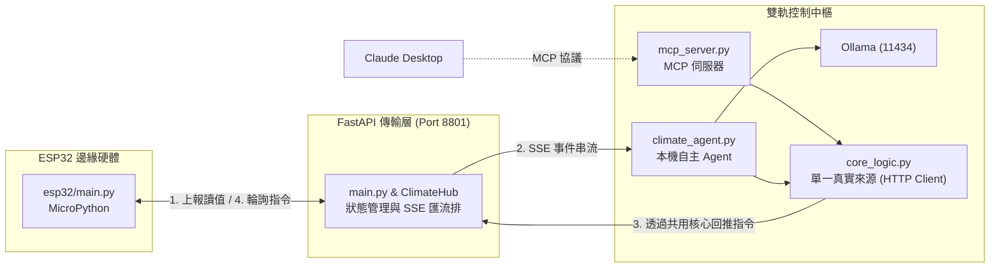
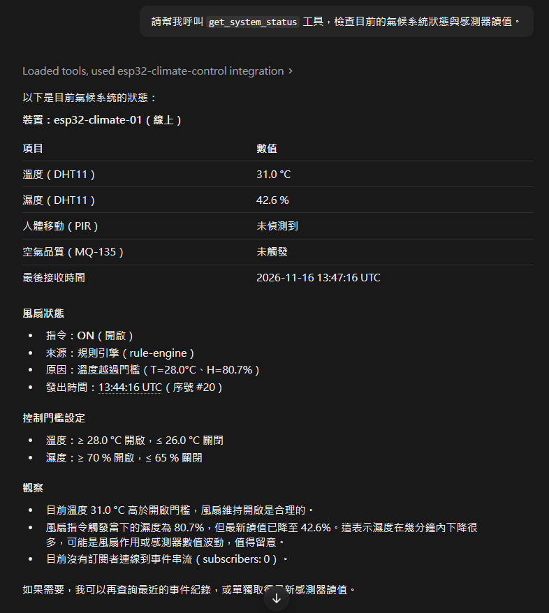
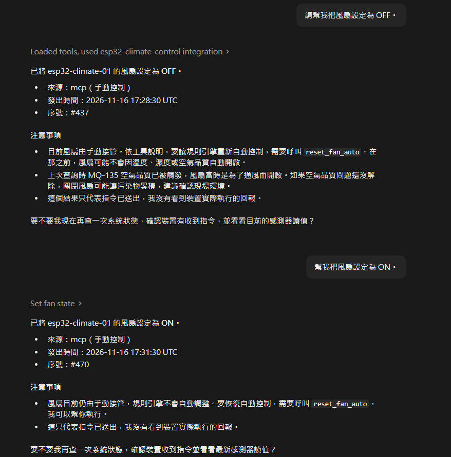

# esp32-mcp-climate-control

**ESP32 + FastAPI + Ollama + MCP 智慧氣候控制**：ESP32 上報環境讀值，由本機 FastAPI
傳輸層串流，交給「規則引擎 + LLM」混合決策後回推風扇指令。

### 系統架構

三層分層：**ESP32 邊緣硬體** → **FastAPI 傳輸層** → **雙軌控制中樞**。



閉環資料流：ESP32 上報 → FastAPI 存檔並以 SSE 推播 → Agent 混合決策後（經 `core_logic`）
回推指令 → ESP32 輪詢取得並驅動風扇。

模組職責：`main.py`（傳輸層）· `core_logic.py`（與 FastAPI 互動的單一真實來源，MCP 與 Agent
共用）· `mcp_server.py`（MCP 橋樑）· `climate_agent.py`（本機自主決策迴圈）· `server/`（FastAPI 應用）。

### 專案目錄結構

```text
esp32-mcp-climate-control/
├── esp32/                     # ESP32 邊緣硬體韌體
│   ├── config.py              # 網路參數與感測器 GPIO 接線設定
│   └── main.py                # MicroPython 主程式（感測器採集與指令輪詢）
├── examples/                  # 範例與輔助程式
│   ├── esp32_simulator.py     # ESP32 裝置模擬器
│   └── mcp_agent_consumer.py  # 無 Ollama 時的模擬決策範例腳本
├── server/                    # FastAPI 後端商務邏輯與狀態管理模組
├── tests/                     # 單元測試與自動化驗證腳本
├── climate_agent.py           # 本機自主 Agent（結合 Ollama 的背景決策迴圈）
├── core_logic.py              # 單一真實來源（HTTP Client 封裝，供 MCP 與 Agent 共用）
├── main.py                    # FastAPI 伺服器啟動入口 (Port 8801)
├── mcp_server.py              # MCP 伺服器（Claude Desktop 與系統溝通的橋樑）
├── pytest.ini                 # Pytest 測試配置設定
└── requirements.txt           # Python 套件依賴清單
```

### 快速開始

```bash
pip install -r requirements.txt

# 1. 啟動傳輸層伺服器（Port 8801）
python main.py

# 2a. 本機自主 Agent 模式（需先執行 Ollama 並拉取模型）
ollama serve && ollama pull qwen2.5-coder:3b
python climate_agent.py --model qwen2.5-coder:3b

# 2b. Claude Desktop 互動模式：把 MCP server 掛進 Claude Desktop（見下方 MCP 整合）

# 3.（選用）若未安裝 Ollama，可改用內建模擬決策的範例腳本
python examples/mcp_agent_consumer.py
```

互動式 API 文件：`http://127.0.0.1:8801/docs`（請換成您的電腦區網 IP）

### API 一覽

| 方法 | 路徑 | 用途 |
| --- | --- | --- |
| `POST` | `/api/climate` | ESP32 上報讀值（JSON） |
| `GET`  | `/api/stream` | SSE 串流，推播 `snapshot` / `reading` / `fan_command` 事件 |
| `GET`  | `/api/fan/command` | ESP32 取得風扇指令（`wait=1` 為 long-poll） |
| `POST` | `/api/fan/command` | MCP / `climate_agent.py` 下達風扇指令 |
| `POST` | `/api/fan/auto` | 把裝置交還規則引擎（解除代理人接管） |
| `GET`  | `/api/health` | 健康檢查 |
| `GET`  | `/api/status` | 系統快照（裝置、最新讀值、風扇狀態） |

### 核心亮點

- **🔒 三層安全底線**：MQ-135 異味超標強制開風扇（不經 LLM）；`T ≥ 31°C` 或 `H ≥ 75%`
  極端氣候強制開啟、過冷維持關閉；AI 若在需要降溫且有人在場時試圖關扇，程式碼強制覆寫為 `ON`。
- **🧠 混合分工**：規則引擎把溫濕度轉為布林旗標（`T ≥ 28°C` 或 `H ≥ 70%` 開；`T ≤ 26°C` 且
  `H ≤ 65%` 關）餵給模型，杜絕幻覺；模型只權衡 PIR 佔用做節能調度；正式 `reason` 一律由程式依真實讀值生成。
- **🛡️ 穩定防護**：非緊急切換需間隔 `--min-switch-seconds`（預設 30 秒）；Ollama 逾時或離線時
  無縫退回規則引擎（`source=rule-engine`）。
- **🔌 MCP 雙軌**：Claude Desktop 透過 `mcp_server.py` 以標準 Tools / Resources 互動；本機 Agent
  結合 Ollama 跑背景決策，兩者共用 `core_logic`。
- **🙋 人類手動介入優先**：一旦 Claude Desktop 手動控制風扇，本機 Agent 偵測到 `manual_override` 即主動退讓，跳過 LLM 推理與指令寫入；此手動鎖定
  **永久持續**，直到呼叫 `reset_fan_auto` 才恢復自動決策，
  確保手動設定不被覆蓋。

### ESP32 接線表

| 元件 | ESP32 腳位 | 備註 |
| --- | --- | --- |
| DHT11 溫溼度 | GPIO 21 | 量測範圍 0～50 °C / 20～90 % |
| PIR 人體感測 | GPIO 14 | 高電位觸發（`PIR_ACTIVE_HIGH = True`） |
| MQ-135 空氣品質 | GPIO 27 | 低電位觸發（`MQ_ACTIVE_LOW = True`） |
| L9110 風扇 | GPIO 22 / 23 | INL / INR，`INL=0/INR=1` 運轉、`INL=0/INR=0` 停止 |

## MCP 整合

`mcp_server.py` 以官方 `mcp` SDK（`MCPServer`）把傳輸層包裝成標準 **MCP Tools / Resources**，
讓 Claude Desktop 等 MCP Client 檢索狀態、接收串流事件並下達風扇指令。伺服器只處理協議層
（stdio / JSON-RPC），**所有後端呼叫都經由 `core_logic.py`**，與 `climate_agent.py` 共用同一組
函式，因此既有的 FastAPI 路由與 `CLIMATE_AUTH_TOKEN` 驗證不受影響（token 以 `X-Device-Token` 轉發）。

**Tools**

| 工具 | 用途 |
| --- | --- |
| `get_system_status` | 全系統快照（裝置、最新讀值、風扇狀態） |
| `get_latest_reading` | 指定裝置的最新讀值 |
| `set_fan_state` | 下達 `ON` / `OFF` 風扇指令（含輸入驗證） |
| `reset_fan_auto` | 將裝置交還規則引擎（解除接管） |
| `poll_fan_command` | 讀取（可 long-poll）佇列中的風扇指令 |
| `get_recent_events` | 從 `/api/stream` SSE 取得最近事件 |

**Resources**

| URI | 內容 |
| --- | --- |
| `climate://status` | 全系統快照（JSON） |
| `climate://devices` | 已知裝置清單（JSON） |
| `climate://devices/{device_id}/reading` | 指定裝置最新讀值（JSON） |
| `climate://devices/{device_id}/fan` | 指定裝置目前風扇指令（JSON） |

**啟動方式**

```bash
# stdio 傳輸（供 Claude Desktop / MCP Inspector 使用；需先啟動 python main.py）
python mcp_server.py --base http://127.0.0.1:8801

# Streamable HTTP 傳輸
python mcp_server.py --transport streamable-http --host 127.0.0.1 --port 8901

# 若傳輸層啟用了 CLIMATE_AUTH_TOKEN
python mcp_server.py --base http://127.0.0.1:8801 --token "$CLIMATE_AUTH_TOKEN"
```

Claude Desktop 設定範例：

```json
{
  "mcpServers": {
    "esp32-climate-control": {
      "command": "python",
      "args": ["/path/to/esp32-mcp-climate-control/mcp_server.py", "--base", "http://127.0.0.1:8801"]
    }
  }
}
```

### Demo

透過 Claude Desktop 連結 MCP 伺服器後，即可直接透過自然語言查詢環境數據或遙控硬體：

**1. 查詢即時系統狀態與感測器讀值**：


**2. 下達控制指令（開關風扇）與安全提示**：

