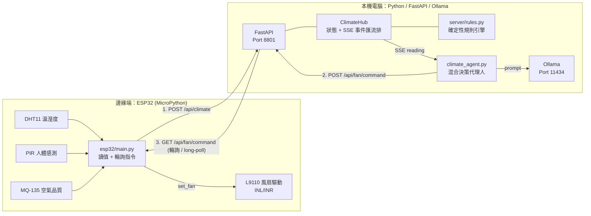

# esp32-mcp-climate-control

ESP32 + MCP + Ollama 本機氣候控制系統。本 repo 實作了架構圖中 **「本機電腦（PC）傳輸層」**
與 **「環境代理人」** 兩部分：

- **FastAPI 伺服器（Port 8801）**：接收 ESP32 上報的多模態空間感知資料
  （DHT11 溫溼度 + PIR 人體動態 + MQ-135 空氣品質），以 SSE 即時推播，並提供風扇指令下行通道。
- **`climate_agent.py` 環境代理人**：訂閱 SSE，以「規則引擎 + LLM」混合模式決策，回推風扇指令。

## 系統架構



資料流：ESP32 上報讀值 → FastAPI 存進 `ClimateHub` → 規則引擎先算出初步指令 →
透過 SSE 推播 `reading` 事件 → `climate_agent.py` 混合決策後 `POST /api/fan/command` 回推 →
ESP32 以輪詢 / long-poll 取得指令並驅動風扇。

## 專案結構

```
.
├── main.py                  # 進入點：python main.py（監聽 0.0.0.0:8801）
├── climate_agent.py         # 環境代理人：混合決策（規則算氣候 + LLM 權衡 PIR）
├── requirements.txt
├── pytest.ini
├── server/
│   ├── app.py               # FastAPI 應用與所有路由
│   ├── config.py            # 環境變數設定（Settings）
│   ├── models.py            # Pydantic 資料模型（讀值 / 風扇指令）
│   ├── state.py             # ClimateHub：狀態儲存 + SSE 事件匯流排
│   └── rules.py             # 確定性規則引擎 + 遲滯輔助
├── examples/
│   ├── esp32_simulator.py    # 模擬 ESP32：上報資料 + 輪詢指令
│   └── mcp_agent_consumer.py # 精簡版 MCP 消費者（佔位決策，示範用）
├── esp32/                    # ⚠️ 放到開發板上的 MicroPython 韌體
│   ├── main.py               # 讀 DHT11 + PIR + MQ-135 → 上報 → 輪詢 → 驅動 L9110
│   └── config.py             # WiFi、PC IP、腳位設定（要先編輯）
└── tests/
    ├── test_transport.py     # 傳輸層 + 規則引擎（含真實 SSE 串流）
    └── test_climate_agent.py # 代理人決策 / 解析 / 降級 / 防抖
```

## 安裝與執行

```bash
python -m venv .venv && source .venv/bin/activate   # 選用
pip install -r requirements.txt

python main.py        # 啟動伺服器（Port 8801）
# 或： uvicorn server.app:app --host 0.0.0.0 --port 8801
```

互動式 API 文件：<http://127.0.0.1:8801/docs>

## API 一覽

| 方法 | 路徑 | 用途 |
| --- | --- | --- |
| `POST` | `/api/climate` | ESP32 上報讀值（JSON） |
| `GET`  | `/api/stream` | SSE 串流，推播 `snapshot` / `reading` / `fan_command` 事件 |
| `GET`  | `/api/fan/command` | ESP32 取得風扇指令（`wait=1` 為 long-poll） |
| `POST` | `/api/fan/command` | MCP / `climate_agent.py` 下達風扇指令 |
| `POST` | `/api/fan/auto` | 把裝置交還規則引擎（解除代理人接管） |
| `GET`  | `/api/health` | 健康檢查 |
| `GET`  | `/api/status` | 系統快照（裝置、最新讀值、風扇狀態） |

### 1. 上報資料 — `POST /api/climate`

```bash
curl -X POST http://127.0.0.1:8801/api/climate \
  -H 'Content-Type: application/json' \
  -d '{"device_id":"esp32-climate-01","dht11_temperature":31.2,"dht11_humidity":55.0,"pir_motion":true,"mq_triggered":false}'
```

回應會附帶目前應套用的風扇指令，ESP32 可在同一次往返就取得結果：

```json
{
  "status": "ok",
  "reading": {"device_id": "esp32-climate-01", "dht11_temperature": 31.2, "dht11_humidity": 55.0, "pir_motion": true, "mq_triggered": false, "...": "..."},
  "fan_command": {"command": "ON", "reason": "temperature crossed threshold (T=31.2C, H=55.0%)", "source": "rule-engine", "seq": 1}
}
```

| 欄位 | 必填 | 說明 |
| --- | --- | --- |
| `dht11_temperature` | ✅ | 攝氏溫度，範圍 `0~50`（超出回 `422`） |
| `dht11_humidity` | ✅ | 相對溼度 `%`，範圍 `20~90`（超出回 `422`） |
| `device_id` |  | 裝置識別碼，預設 `esp32-climate-01` |
| `timestamp` |  | 裝置時鐘；省略則用伺服器時間 |
| `pir_motion` |  | PIR 偵測到人體動態，預設 `false` |
| `mq_triggered` |  | MQ-135 DO 已觸發，預設 `false` |

`pir_motion` / `mq_triggered` 皆可省略（預設 `false`），因此舊韌體仍相容。

### 2. SSE 串流 — `GET /api/stream`

MCP 核心與 `climate_agent.py` 訂閱此端點。連線後先收到一筆 `snapshot`，之後每當有新讀值或
新指令就即時推播：

```
event: snapshot
data: {"seq": 3, "readings": {...}}

event: reading
data: {"device_id": "esp32-climate-01", "dht11_temperature": 30.0, "dht11_humidity": 75.0, "pir_motion": true, "mq_triggered": false, "...": "..."}

event: fan_command
data: {"device_id": "esp32-climate-01", "command": "ON", "reason": "...", "source": "climate_agent", "seq": 4}
```

```bash
curl -N http://127.0.0.1:8801/api/stream
```

伺服器會定期送出 keep-alive 註解訊框，避免代理伺服器逾時斷線。

### 3. 風扇指令通道 — `GET /api/fan/command`

ESP32 兩種取用方式都支援：

```bash
# (a) 單純輪詢：立即回傳目前指令
curl "http://127.0.0.1:8801/api/fan/command?device_id=esp32-climate-01"

# (b) long-poll：若沒有比 since_seq 更新的指令，最多等待 25 秒
curl "http://127.0.0.1:8801/api/fan/command?device_id=esp32-climate-01&since_seq=3&wait=1"
```

建議韌體記錄上次收到的 `seq`，下次帶入 `since_seq`，就能在指令變更時立即被喚醒。

### 4. 代理人下達指令 — `POST /api/fan/command`

由 MCP / `climate_agent.py`（Ollama 推理後）呼叫：

```bash
curl -X POST http://127.0.0.1:8801/api/fan/command \
  -H 'Content-Type: application/json' \
  -d '{"command":"ON","reason":"agent: T=31C H=72% -> cool/dry","device_id":"esp32-climate-01"}'
```

`device_id` 省略時會廣播給所有已知裝置。代理人下達指令後，規則引擎會暫時退讓
（預設 60 秒，`AGENT_OVERRIDE_TTL_S`），避免兩者互相搶控；可用
`POST /api/fan/auto?device_id=...` 立即交還控制權。

## 多模態混合決策

整個系統的決策核心是 `climate_agent.py`，採**單一混合模式**（無 `--mode` 切換）：
規則引擎負責確定性的溫溼度判斷，LLM 負責多模態情境權衡，程式碼則守住安全底線。
三種模態感測各司其職：

| 模態 | 來源 | 由誰處理 | 角色 |
| --- | --- | --- | --- |
| 溫溼度 | DHT11 | 規則引擎（`server/rules.py`，含遲滯） | 算出 `climate_needs_cooling` / `climate_is_extreme` 語意旗標 |
| 人體動態 | PIR | LLM（在安全封套內） | 佔用／節能權衡 |
| 空氣品質 | MQ-135 | 程式碼（安全底線） | `mq_triggered=true` 一律強制通風 |

### 決策流程（依序、逐層降級）

1. **空氣安全底線（程式碼強制）**：`mq_triggered=true` → 直接輸出 `ON` 通風，**不呼叫 LLM**。
2. **氣候預處理（程式碼）**：呼叫 LLM 前，先用 `server/rules.py` 的遲滯邏輯算出
   `climate_needs_cooling` 與 `climate_is_extreme`。模型**不會拿到原始溫度/濕度數字**，
   因此無法做數字比較，也就不會幻覺或邊緣震盪。
3. **LLM 情境調度**：模型只依據語意旗標（`climate_needs_cooling`、`climate_extreme`、
   `pir_motion`、`current_fan`）結合佔用狀態做節能與舒適度權衡。例如
   `climate_needs_cooling=true` 但 `pir_motion=false` 且非極端時，模型可基於節能維持 `OFF`。
4. **安全封套（程式碼攔截）**：模型若在**極端氣候**（過熱／過濕）或**需要降溫且有人在場**時
   想關風扇，程式碼強制改回 `ON`。**過冷不算極端**——風扇無法加熱，室溫過低時維持 `OFF`。
5. **自動降級（Fallback）**：Ollama 離線、逾時或回傳無效 JSON 時，捕捉例外並由
   `server/rules.py` 的 `decide_fan` 接管，`source` 標示為 `rule-engine`，確保無 AI 時仍穩定運作。
6. **防連跳**：非緊急切換需間隔 `--min-switch-seconds`（預設 30 秒）；MQ 觸發與極端氣候
   視為緊急、可立即切換。

### 為什麼不讓模型直接看數字？

小模型（如 `qwen2.5-coder:3b`）**不擅長精確的數值比較**，會出現兩種典型症狀：

1. **理由幻覺**：讀值明明是 T=28.0 / H=68.0，卻生成「humidity is below 65%」這種與數據
   矛盾的說明——因為 LLM 是在「生成聽起來合理的句子」，不是真的在比大小。
2. **邊界震盪**：28.0 °C 剛好卡在 `temp_on_c=28`，模型每次取樣都可能翻面，且本身沒有
   遲滯（hysteresis），於是上一秒 ON、下一秒 OFF。

因此把工作依「誰擅長什麼」分工：溫溼度交給確定性的 `server/rules.py`（含遲滯，永不與數字矛盾）；
多模態情境（PIR 佔用／節能、當前風扇狀態）交給 LLM 權衡；安全底線（MQ-135、極端高溫／高濕）
由程式碼強制執行；**正式理由一律由程式依真實讀值生成**（`Agent._describe`），
模型寫的自由文字**絕不會**成為正式理由。

### 規則引擎的多模態決策優先序（`server/rules.py`）

1. **空氣品質優先**：`mq_triggered=true` → 一律開風扇通風（即使涼爽、無人）。
2. **舒適帶（含遲滯）**：`T ≥ 28 °C` 或 `H ≥ 70 %` 開；`T ≤ 26 °C` 且 `H ≤ 65 %` 才關。
3. **PIR 節能**：無人（`pir_motion=false`）且已在舒適帶 → 傾向關閉省電；
   但「過熱／過濕」與「空氣品質」仍優先開啟。

### 執行與觀測

```bash
# 前置：Ollama 執行中，且已拉取模型
ollama serve &
ollama pull qwen2.5-coder:3b

python climate_agent.py --model qwen2.5-coder:3b
```

模型收到的 prompt（語意狀態，無原始數字）：

```
device_id: demo
climate_needs_cooling: True
climate_extreme: False
pir_motion: False
mq_triggered: False
current_fan: OFF
Decide the fan command now.
```

`[DECIDE]` 輸出同時顯示決策結果、來源（`climate_agent` 或降級時的 `rule-engine`）
以及 AI 的簡短理由（`| llm ...` 為模型原始文字，僅供觀測，可能與結果不同）：

```
[DECIDE] esp32-climate-01 T=28.0 H=68.0 cool=True motion=True mq=False -> ON (climate_agent: ON: climate needs cooling (T=28.0C, H=68.0%)) | llm occupant present, cooling required
[DECIDE] esp32-climate-01 T=24.0 H=45.0 cool=False motion=False mq=True -> ON (rule-engine: MQ-135 air quality threshold exceeded -> ventilate (T=24.0C, H=45.0%))
```

（第二行的 `rule-engine` 就是 Ollama 不可用時的自動降級。）

常用參數：

| 參數 | 預設 | 說明 |
| --- | --- | --- |
| `--base` | `http://127.0.0.1:8801` | 傳輸層位址 |
| `--ollama` | `http://127.0.0.1:11434` | Ollama 位址 |
| `--model` | `qwen2.5-coder:3b` | 模型名稱 |
| `--token` | 無 | 對應伺服器的 `CLIMATE_AUTH_TOKEN` |
| `--min-switch-seconds` | `30` | 非緊急情況下兩次切換的最短間隔（防抖） |
| `--dry-run` | 關 | 只印決策、不推送指令 |

> ⚠️ **MQ-135 安全聯鎖**：`mq_triggered=true` 是**安全事件**，一律由規則引擎直接強制開風扇
> 通風，模型與舒適帶都不能推翻它。

## ESP32 端（MicroPython）

`esp32/` 是要放到開發板上的韌體，**不是**在電腦上跑的。

### 硬體接線

| 元件 | ESP32 腳位 | 備註 |
| --- | --- | --- |
| DHT11 資料腳 | GPIO21 | 溫溼度，量測範圍 0~50 °C / 20~90 % |
| PIR 人體感測（數位輸出） | GPIO14 | 高電位觸發（`PIR_ACTIVE_HIGH = True`） |
| MQ-135 空氣品質 DO（數位輸出） | GPIO27 | 低電位觸發（`MQ_ACTIVE_LOW = True`） |
| L9110 馬達驅動 INL | GPIO22 | 風扇控制輸入 |
| L9110 馬達驅動 INR | GPIO23 | 風扇控制輸入 |

風扇由 L9110 馬達驅動 IC 控制，兩支接腳的輸出組合固定寫在 `esp32/main.py` 的 `set_fan()`：

```python
def set_fan(on):
    if on:
        relay_inl.value(0)   # INL=0 / INR=1 → 運轉
        relay_inr.value(1)
    else:
        relay_inl.value(0)   # INL=0 / INR=0 → 停止
        relay_inr.value(0)
```

PIR 與 MQ-135 的觸發極性可在 `esp32/config.py` 調整，韌體會依設定轉成邏輯值後再上報
（`pir_motion`、`mq_triggered` 一律是「事件發生 = `true`」）。

### 部署步驟

1. 編輯 `esp32/config.py`：
   - `WIFI_SSID` / `WIFI_PASSWORD`
   - `SERVER_HOST` 改成**跑 FastAPI 那台電腦的區網 IP**（例如 `192.168.0.100`）
   - 若伺服器有設 `CLIMATE_AUTH_TOKEN`，把相同值填進 `DEVICE_TOKEN`
2. 把兩個檔案上傳到 ESP32（以 `mpremote` 為例）：

   ```bash
   mpremote connect /dev/ttyUSB0 fs cp esp32/config.py :config.py
   mpremote connect /dev/ttyUSB0 fs cp esp32/main.py   :main.py
   mpremote connect /dev/ttyUSB0 reset
   ```

3. ESP32 開機後會自動執行：連 Wi-Fi → 每 5 秒讀 DHT11 + PIR + MQ-135 並 `POST /api/climate`
   → 依回應與 `GET /api/fan/command` 的指令驅動 L9110 風扇。

> ⚠️ `SERVER_HOST` 不能填 `192.168.0.0` —— 那是網段位址，不是可連線的主機。
> 要用電腦的實際 IP（Windows 用 `ipconfig`，Linux/macOS 用 `ip addr` 查）。

### 讀值防呆（DHT11）

DHT11 的實體量測範圍為 **溫度 0~50 °C、濕度 20~90 %**。上電初期、線路鬆脫或讀取時序干擾
常會產生範圍外的亂碼；韌體在 `read_sensor()` 會先過濾（`reading_is_valid()`），超出範圍或
`NaN` 的讀值直接丟棄、重試（最多 3 次），**不會上報**，因此也不會在後端觸發 `422`。
範圍常數定義在 `esp32/config.py`（`DHT11_TEMP_MIN_C` 等），與 `server/models.py` 的驗證範圍一致。

## 端到端試跑

開三個終端機：

```bash
python main.py                         # 1. 伺服器
python climate_agent.py                # 2. 環境代理人（需先啟動 Ollama）
python examples/esp32_simulator.py     # 3. 模擬 ESP32 上報
```

沒有 Ollama 時，可用 `examples/mcp_agent_consumer.py` 取代第 2 步（佔位決策）。

## 結構化日誌

伺服器使用標準 `logging`（logger 名稱 `climate.transport`、`climate.hub`、`climate.main`），
啟動時即可從終端機追蹤資料流。日誌等級可用環境變數 `CLIMATE_LOG_LEVEL`（預設 `INFO`）調整。

| 事件 | 等級 | 內容 |
| --- | --- | --- |
| `POST /api/climate` | INFO | 來源 IP、`device_id`、溫溼度、控制模式（`auto` / `agent`）、最終風扇指令與來源 |
| 驗證失敗 `422` | WARNING | 逐欄列出錯誤欄位、輸入值、訊息與來源 IP（結構化 `detail`） |
| 未授權 `401` | WARNING | 來源 IP、方法、路徑、token 是缺漏或無效 |
| 網域錯誤 `ValueError` | ERROR | 來源 IP、方法、路徑與錯誤訊息 |
| `GET /api/stream` | INFO | 訂閱者連線建立 / 斷線，以及目前線上訂閱者總數 |
| `GET /api/fan/command` | INFO | 輪詢 / long-poll 結果（含逾時與被喚醒事件） |
| `POST /api/fan/command` | INFO | 來源 IP、目標裝置、指令、`source`、`reason` |
| `POST /api/fan/auto` | INFO | 重置裝置與是否原本為代理人控制 |
| 規則引擎決策 | INFO | 讀值、決策與原因；代理人覆寫期間會記錄「跳過規則引擎」 |

`422` 回應為結構化格式，方便 ESP32 端或測試直接讀取錯誤欄位：

```json
{"status": "error", "detail": [{"field": "body.dht11_temperature", "input": 99.0, "message": "...", "type": "..."}]}
```

## 設定（環境變數）

| 變數 | 預設 | 說明 |
| --- | --- | --- |
| `CLIMATE_HOST` / `CLIMATE_PORT` | `0.0.0.0` / `8801` | 綁定位址與埠 |
| `CLIMATE_LOG_LEVEL` | `INFO` | 日誌等級（`DEBUG` / `INFO` / `WARNING` / `ERROR`） |
| `FAN_TEMP_ON_C` / `FAN_TEMP_OFF_C` | `28` / `26` | 溫度開 / 關閾值（含遲滯） |
| `FAN_HUMIDITY_ON` / `FAN_HUMIDITY_OFF` | `70` / `65` | 溼度開 / 關閾值 |
| `AGENT_OVERRIDE_TTL_S` | `60` | 代理人指令後暫停規則引擎的秒數 |
| `DEVICE_OFFLINE_AFTER_S` | `30` | 超過此秒數未上報視為離線 |
| `LONG_POLL_TIMEOUT_S` | `25` | long-poll 最長等待秒數 |
| `SSE_KEEPALIVE_S` | `15` | SSE keep-alive 間隔 |
| `CLIMATE_AUTH_TOKEN` | 未設定 | 設定後，變更類路由需帶 `X-Device-Token` 或 `?token=` |

## 測試

```bash
pytest
```

涵蓋：上報與規則決策、遲滯行為、多模態（PIR 節能 / MQ-135 通風）、輸入驗證、代理人覆寫、
輪詢 / long-poll、真實 SSE 串流（以 uvicorn 實跑）、token 驗證、健康與狀態端點，以及
`climate_agent` 的單一混合模式（氣候語意旗標、安全封套、Ollama 逾時／無效 JSON 時自動降級）、
理由生成、JSON 解析與防抖護欄。

## 後續整合（尚未實作）

- 以 `mcp` SDK 將 `/api/stream` 與 `/api/fan/command` 包裝成 MCP tools。
- 需要跨行程 / 多實例時，把 `ClimateHub` 的記憶體匯流排換成 MQTT 或 Redis。
